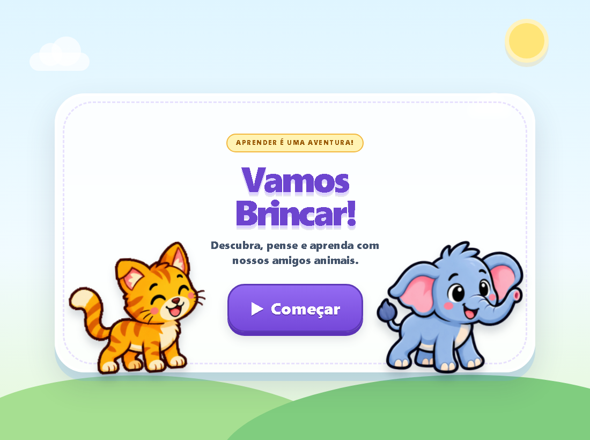
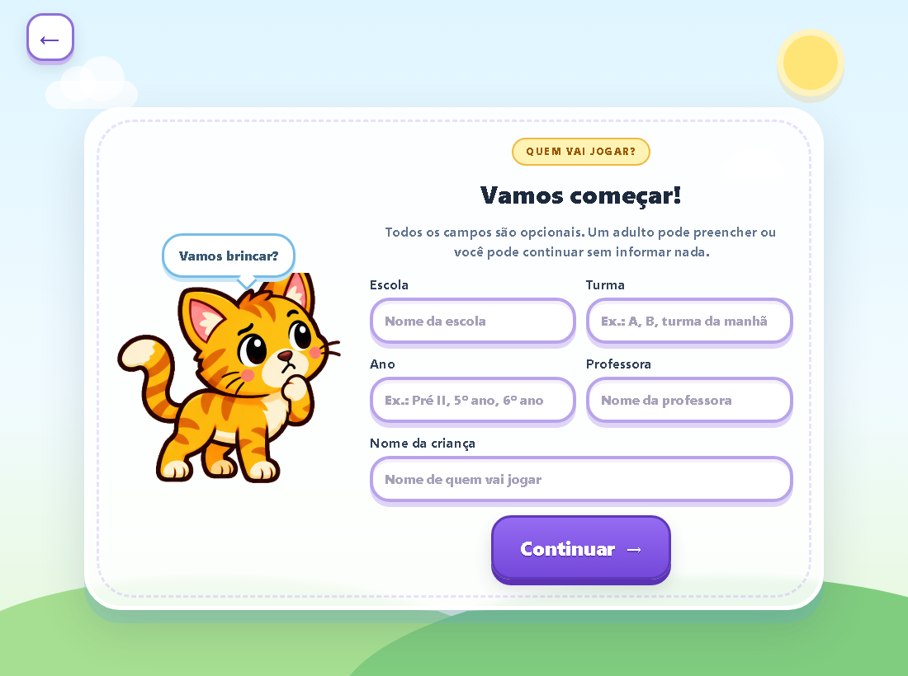
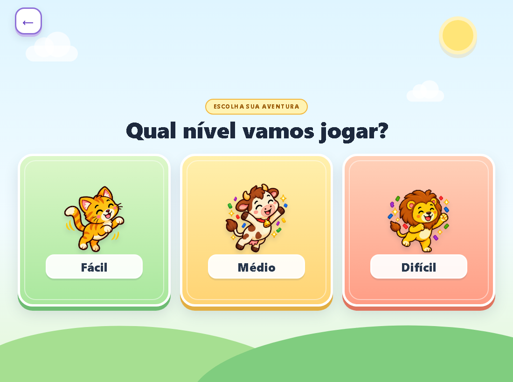
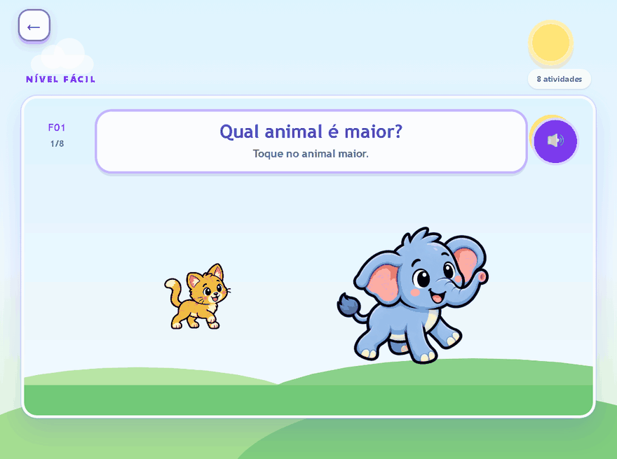
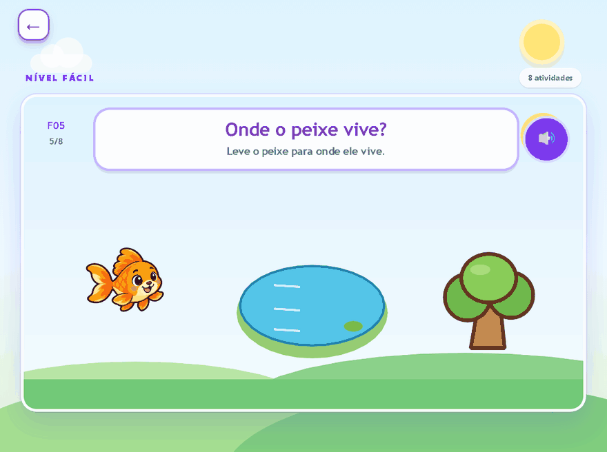
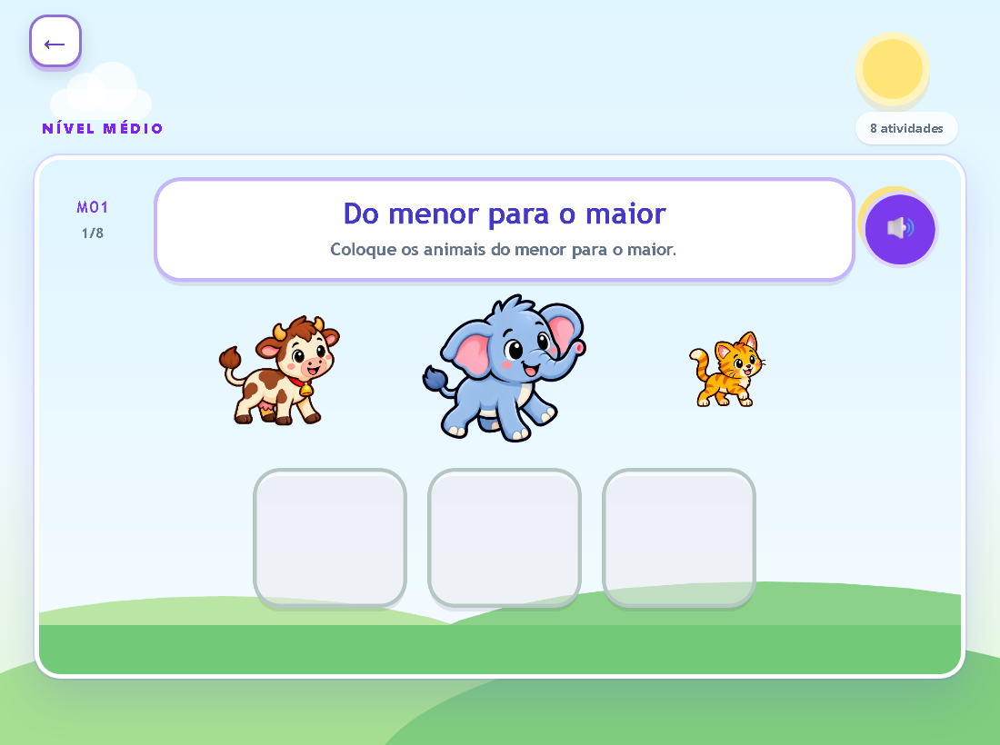

# 🎮 Projeto de Curricularização da Extensão 2026.2 — UNIFEBE & Secretaria Municipal de Educação de Brusque

## 📌 Sobre o projeto

Este projeto acadêmico é desenvolvido em parceria entre o curso de **Sistemas de Informação da UNIFEBE** e a **Secretaria Municipal de Educação de Brusque**, dentro das atividades de Curricularização da Extensão.

A proposta consiste no desenvolvimento de um **jogo educacional interativo** destinado a crianças de **5 a 6 anos**, matriculadas na **Educação Infantil — Pré-escola II**.

O projeto busca aproximar a formação acadêmica de uma demanda real da comunidade, permitindo que os estudantes participem das etapas de levantamento de requisitos, planejamento, design, desenvolvimento, testes e validação de uma solução tecnológica aplicada à educação.

---

## 🎯 Objetivo

Desenvolver uma solução educacional lúdica, simples e intuitiva que auxilie no estímulo e acompanhamento de diferentes habilidades trabalhadas na Educação Infantil.

As atividades trabalham os seguintes conteúdos:

* Grandezas e comparações;
* Noções espaciais;
* Contagem e quantidades;
* Cores;
* Animais e seus habitats;
* Consciência fonológica;
* Consciência silábica;
* Letras e palavras;
* Percepção visual;
* Compreensão auditiva.

---

## 🧩 Funcionamento geral

O jogo reúne **24 perguntas principais**, distribuídas em três níveis:

* **Fácil:** oito perguntas;
* **Médio:** oito perguntas;
* **Difícil:** oito perguntas.

As atividades combinam **animais animados, ilustrações, instruções sonoras e feedback visual**, com ações de escolha, arraste, contagem, associação e ordenação. Nas novas atividades de posicionamento, também é possível selecionar o objeto e depois clicar ou tocar no destino.

A identificação é **inteiramente opcional**: é possível começar sem preencher nome, escola, turma, ano ou professora.

---

## 🧒 Experiência do usuário

Por ser destinado ao público infantil, o projeto prioriza:

* Navegação simples e intuitiva;
* Botões grandes e facilmente identificáveis;
* Poucos elementos simultâneos na tela;
* Uso de imagens e elementos visuais atrativos;
* Redução da necessidade de leitura;
* Recursos sonoros para auxiliar na interação;
* Feedback positivo para respostas corretas;
* Incentivo a novas tentativas em caso de erro;
* Experiência acolhedora e adequada à faixa etária.

---

## 📊 Acompanhamento das atividades

As perguntas estão associadas a **áreas, assuntos e habilidades pedagógicas**. O jogo registra localmente no navegador:

* Identificação, quando fornecida;
* Data e horário;
* Pergunta realizada e habilidade trabalhada;
* Acertos, erros e tentativas avaliadas;
* Progresso durante a atividade e conclusão da partida.

Ao finalizar, a tela de resultados apresenta o resumo da **partida atual**, com detalhamento por pergunta e habilidade. Esses registros podem apoiar o acompanhamento pedagógico; o conteúdo permanece sujeito à validação da equipe de Educação.

---

## 🖼️ Conheça o jogo

<strong>Ver seis telas do jogo — capturas e GIFs</strong>

### Tela inicial

Entrada para as atividades, com os animais que acompanham a experiência.

### Identificação opcional

Escola, turma, ano, professora e nome da criança podem ser informados. Todos os campos podem ficar vazios.

### Escolha do nível

Três níveis, cada um com oito perguntas principais.

### Qual animal é maior?

Animação dos personagens na atividade de comparação de tamanhos.

### Onde o peixe vive?

Demonstração do arraste do peixe até a água e do feedback de acerto.

### Do menor para o maior

Atividade de ordenação com gato, vaca e elefante.

---

## 👥 Integrantes

* Vinicius Fernandes
* Ygor Luiz Volstein

---
